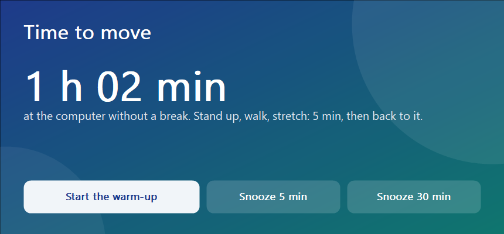
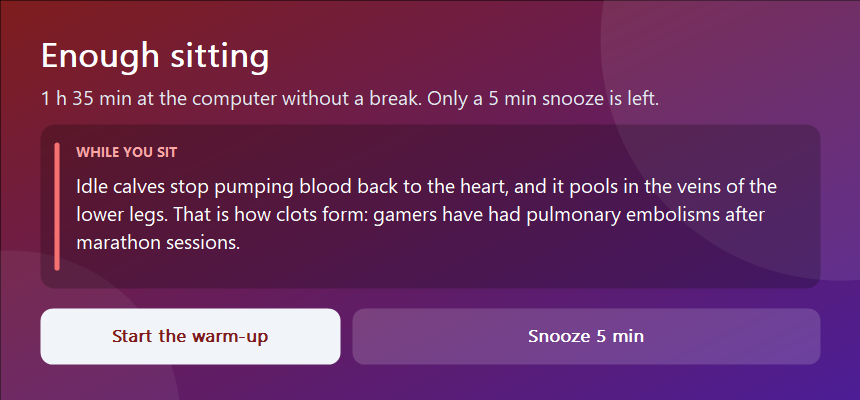
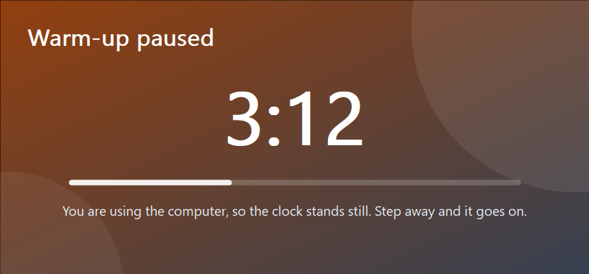

# sitnag

Short for sit-nag. A Windows tray tool that counts the time you spend at the
computer and, after an hour, asks for a five-minute warm-up. I know what the
warm-up is; what I kept doing was sitting for three hours straight.



It is small, stays in the tray, and is hard to wave away: the window sits on
top of everything, has no close box, and a warm-up only counts if you actually
leave the keyboard.

## What it does

- **Counts real time at the computer.** The count grows while the keyboard or
  mouse is in use. Ten minutes without input, a locked screen or sleep count as
  a break and start it over; five minutes for coffee do not.
- **Asks after an hour.** A window in the middle of the screen offers to start
  the warm-up or to snooze for 5 or 30 minutes.
- **Stops bargaining at ninety minutes.** From there only the 5-minute snooze
  is left, a 30-minute one taken earlier ends at the ninety-minute mark, and
  every reminder turns red and carries a fact about what sitting does to the
  body. Each fact has its study next to it in [facts.go](facts.go).
- **Counts only a real warm-up.** The five-minute countdown runs only while
  the keyboard and mouse are left alone. Touch them and it stops, so pressing
  "start" and carrying on working earns nothing.

| Past ninety minutes | Warm-up, paused while you use the computer |
|---|---|
|  |  |

The interface is in English or Russian, picked from the first language in the
Windows language list (Settings > Time & language). `-lang en` or `-lang ru`
overrides it.

## Install

There is no prebuilt download: you build it yourself from this repository,
which takes a minute. Every step below is a command, so a coding agent with
shell access can do it too: "install sitnag from github.com/vusty/sitnag
following its README".

You need Windows 10 or 11 (x64), [Go](https://go.dev/dl/) 1.27 or newer, and
git. In PowerShell:

```powershell
# Go and git, if they are not installed yet; open a new terminal afterwards
winget install GoLang.Go Git.Git

git clone https://github.com/vusty/sitnag.git
cd sitnag
go build -ldflags "-H=windowsgui -s -w" -o sitnag.exe .

# Put it where it will live, start it with Windows, and start it now
$dir = "$env:LOCALAPPDATA\Programs\sitnag"
$log = "$env:LOCALAPPDATA\sitnag\sitnag.log"
New-Item -ItemType Directory -Force $dir | Out-Null
Copy-Item sitnag.exe $dir
& "$dir\sitnag.exe" autostart on -log $log | Out-Host
Start-Process "$dir\sitnag.exe" -ArgumentList "run", "-log", $log
```

A green dot appears in the tray. Hover over it to see how long you have been
sitting. `-H=windowsgui` builds it without a console window, and `-log` is the
only way to see afterwards what it decided and when.

From Linux, macOS or WSL the same binary cross-compiles, no cgo involved:

```sh
GOOS=windows GOARCH=amd64 go build -ldflags "-H=windowsgui -s -w" -o sitnag.exe .
```

The executable is not signed. Windows may warn about an unknown publisher, and
Smart App Control, when it is on, blocks unsigned programs outright, self-built
ones included; it has no per-app exception.

### Uninstall

```powershell
& "$env:LOCALAPPDATA\Programs\sitnag\sitnag.exe" autostart off | Out-Host
```

Then choose Quit in the tray menu and delete `%LOCALAPPDATA%\Programs\sitnag`
and the log folder `%LOCALAPPDATA%\sitnag`.

## Settings

All settings are flags of `run`. Anything after `autostart on` is stored and
passed to `run` at logon, so to change a setting run `autostart on` again with
the new flags, then restart sitnag from the tray.

| Flag | Default | What it sets |
|---|---|---|
| `-remind` | `60m` | time at the computer before the first reminder |
| `-limit` | `90m` | past this only the short snooze is left, and the reminder turns red |
| `-away` | `10m` | no input this long counts as having left, and the count starts over |
| `-break` | `5m` | length of the warm-up |
| `-busy` | `5s` | input this recent pauses the warm-up |
| `-short`, `-long` | `5m`, `30m` | the two snoozes |
| `-lang` | `auto` | `auto`, `en` or `ru` |
| `-log` | none | append a log of decisions to this file |

For example, a reminder every 45 minutes:

```powershell
& "$env:LOCALAPPDATA\Programs\sitnag\sitnag.exe" autostart on -remind 45m -limit 75m -log "$env:LOCALAPPDATA\sitnag\sitnag.log" | Out-Host
```

Small values make a quick end-to-end check:
`sitnag.exe run -remind 15s -limit 45s -break 10s -short 10s -long 30s`.

## How it decides

The time comes from `GetLastInputInfo`, the moment of the last keyboard or
mouse input anywhere in the session. The tool checks it once a second.

- Ten minutes with no input, a locked screen, or a gap that means the machine
  slept: you left, and the count starts over. Walking away while the reminder
  is up counts as the break too, and the window goes.
- During the warm-up, only time with no input for at least five seconds comes
  off the clock. The click on the start button does not count as use. While you
  type, the window turns amber and says so.
- The window never takes the keyboard focus (`WS_EX_NOACTIVATE`), so a
  keystroke meant for the editor cannot press one of its buttons. It ignores
  Alt+F4: it goes away through its buttons, or through Quit in the tray.

The tray dot is green while counting, orange while the reminder is up, and
blue during the warm-up.

## Limits

Idle is input only. An hour on a call spent listening without touching the
mouse reads as having left the computer, and reading a long page without
scrolling during the warm-up reads as being away.

## Development

    go test ./internal/sit          the decision logic; runs on any OS
    GOOS=windows go vet ./...

The window paints itself on a gradient: GDI+ draws the shapes, GDI the text.
To look at all four screens without waiting for them, build the render test and
run it on Windows; it writes the PNGs this README shows:

    GOOS=windows go test -c -o win.test.exe ./internal/win
    SITNAG_RENDER=C:\temp\sitnag win.test.exe -test.run Render

[granag](https://github.com/vusty/granag) is its sibling: it reminds you to
start recording in Granola when you unmute the microphone.

## License

MIT, see [LICENSE](LICENSE).
